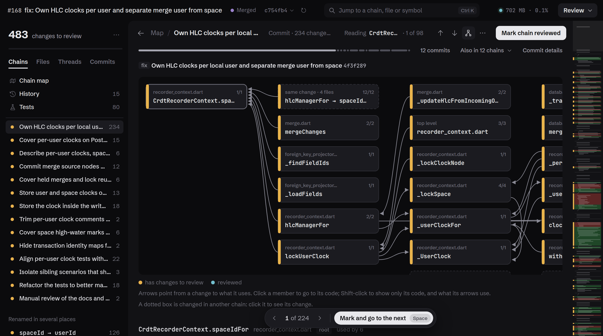
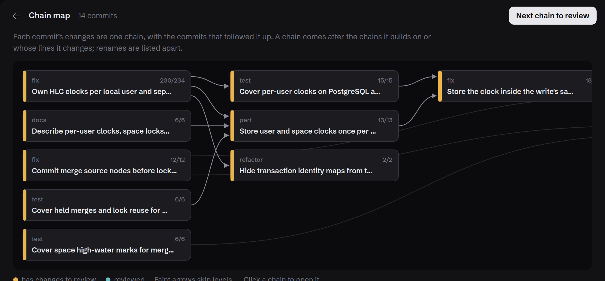
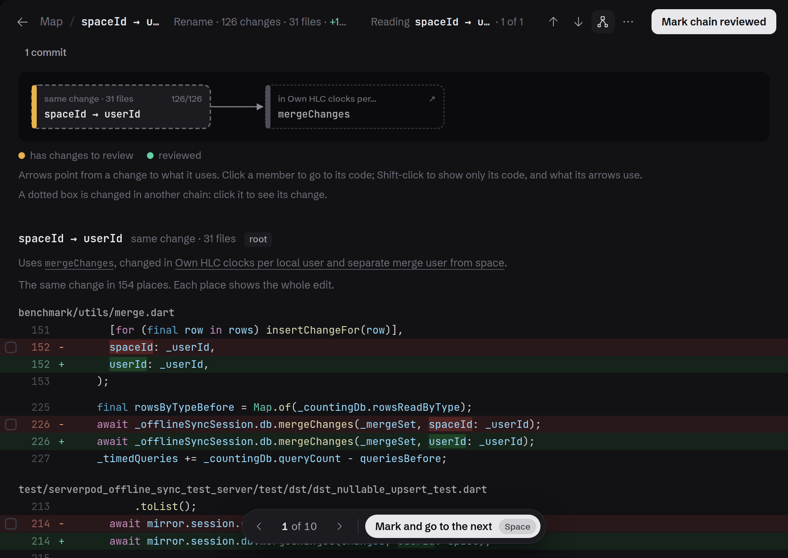
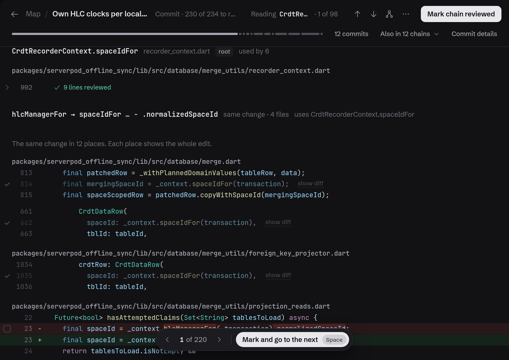
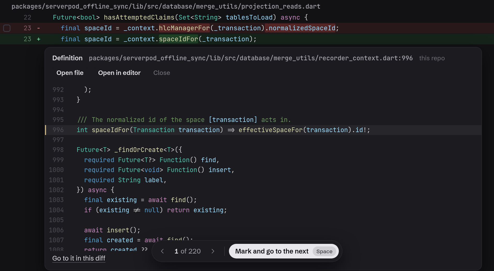
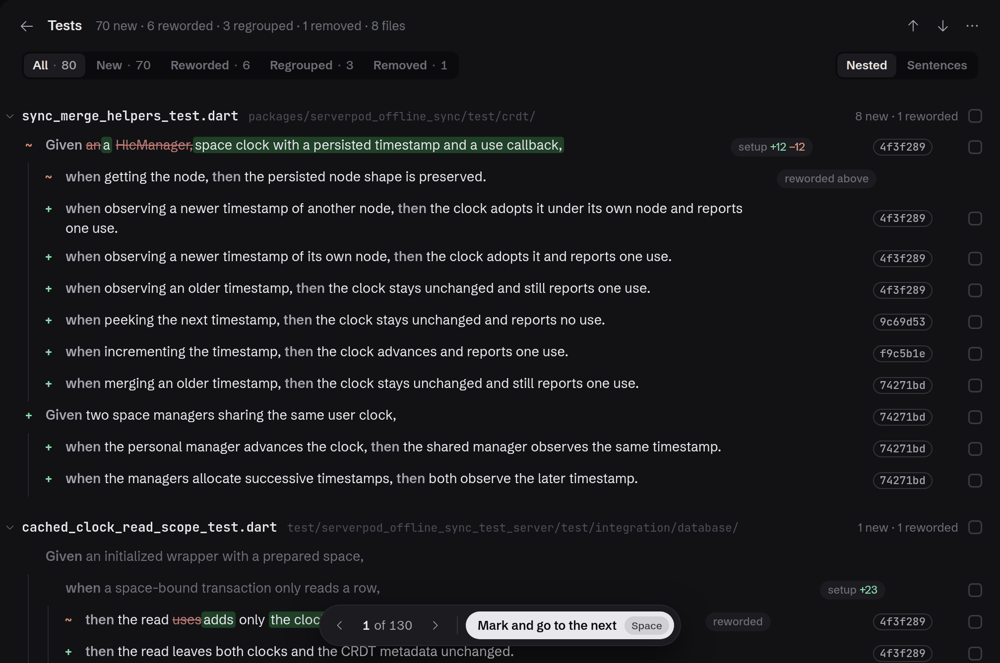
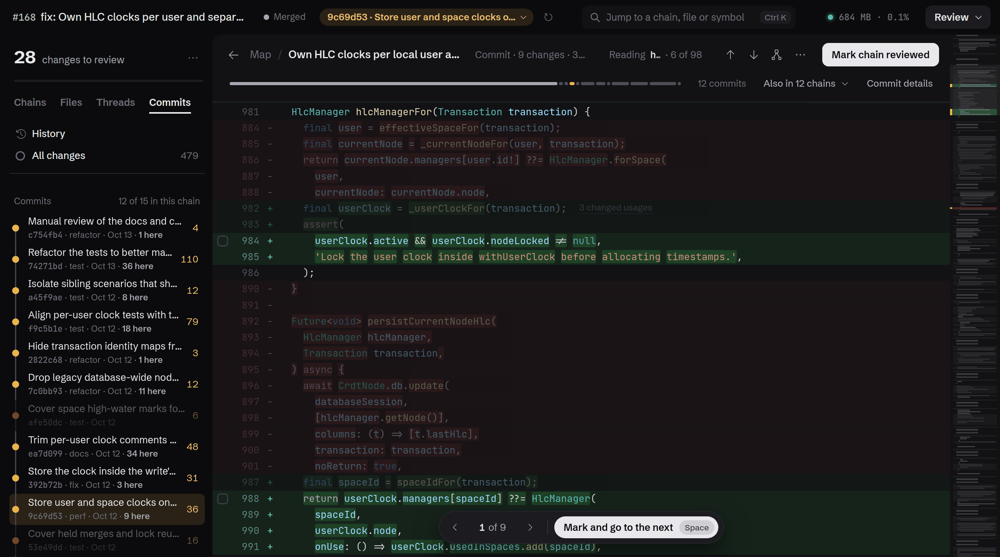

# untangle

Review a pull request by what changed, not file by file.

A pull request is a handful of changes and the code each one drags along: a renamed parameter
touches every caller, a model change regenerates its classes and a migration. untangle reads it
that way. It follows each change across files, reads a rename or a repeated edit once, keeps
generated code out of the count, and remembers what you reviewed down to the line, across new
pushes. It runs on your machine and opens in your browser.



```
untangle                 # the pull request of the current branch, from its directory
untangle <pr-url>        # any pull request on GitHub, cloned into the cache
```

The screenshots are serverpod_offline_sync
[#168](https://github.com/marcelomendoncasoares/serverpod_offline_sync/pull/168): 15 commits and
483 changes, read as 14 chains and 7 renames.

## Features

### Chains, not files

A chain is one change followed across files: the commit that started it, the calls it changed,
and the code that had to change in turn. Each commit and the commits that later touched its lines
make one chain, named after it and opening with its message, so back-and-forths don't repeat. A
chain reads as a graph of what each change uses; the map shows which chains build on which.
`-chains structure` follows the code alone, without the commits.



### A rename is one change

The same edit in many places reads once. In #168, `spaceId → userId` is 126 changes in 31 files
and one row in the sidebar: each place shows its whole edit, and they can be marked together or
one at a time. Moved code shows only its real edits, with the old copy as one line that opens the
new one. Generated code (Serverpod's classes and migrations, build_runner, protobuf, files marked
`linguist-generated`, or patterns in `.review.yaml`) is not reviewed or counted, and opens
read-only.



### Mark changes, not files

Space marks the change in front of you and goes to the next; the pill under the code says where
you are among the changes left ("1 of 224"). Reviewed code stays on screen, muted, and a hunk
folds away once its last change is reviewed. Your review is a local git branch,
`untangle/pr-<number>` (or `untangle/<branch>`): the base plus every change you marked. A new
push brings back only what changed since you looked, and a rebase replays your marks onto the new
base.



### Go to definition anywhere

Click a name on any line, added or removed, to read its definition in place. Names on changed
lines answer at once; any other name asks the Dart language server, from the base or the head.
A click inside the peek follows the next name. Ctrl K jumps to a chain, a file, a thread or any
declaration in the repository, and searches the code.



### Tests as sentences

A test's group and test titles join into the sentence it asserts: Given …, when …, then ….
The Tests view lists every sentence the pull request adds, rewords, regroups or removes, with the
reworded words marked and the commit that wrote each. A chain shows the test files it changes the
same way. Reviewed tests fold into one line, and a test file can be reviewed whole.



### The commits, as a lens

The Commits tab draws the pull request's commits as a graph. Pick one, or a range, and every view
reviews through it: lines from other commits fade, and the counts, the pill and the keys go
through its changes. After a new push, "Since your review" shows what changed since you last
looked. History shows each commit with its files, checks and reviews, and the heads a force push
replaced.



### And

- **The pull request's conversation**, through `gh`: threads under their lines, replies,
  reactions and suggestions. Comment on a line, a range or a file, resolve threads, and submit a
  review.
- **Refresh in place.** When the pull request gets new commits, a banner offers to refresh. Marks
  carry over and unsent comments stay.
- **Calm, and nothing jumps.** Amber marks what's left to review, a check what's done, and blue
  what comes from GitHub. Marking a hunk folds it while the code below glides up. Peeks grow from
  their line and fold back. With reduced motion set, none of it moves.
- **Keys:** j and k for the next and previous change to review, Space to mark it and go on, n and
  p for the next and previous chain, g for the chain's graph, c to comment, Ctrl K to jump, Esc to
  close. `?` lists them all.
- **Share it read-only:** `-export review.html` writes the review as one HTML file.

## Install

Needs Node 22 or later, git 2.40 or later, and Dart 3.12 or later (`dart` on `PATH`; Flutter's
works). `gh` is optional: it finds a directory's pull request, reads private repositories, and
brings the comments and reviews. untangle asks GitHub through `gh` as your own login, so it never
handles a token. Without `gh`, GitHub's public API answers for public repositories, without
comments.

```
npm install
npm run build   # TypeScript, the native Dart extractor, the highlighter and the fonts
npm link        # puts `untangle` on PATH
```

The build compiles the Dart extractor into `dist/dart-analyzer`. Rebuild after changing platforms
or upgrading the Dart SDK.

## Usage

```
untangle [flags] [directory]
untangle [flags] <pr-url>
```

- **A directory** (default `.`) reviews the pull request of its branch, found with `gh`. Without
  one, it reviews what the branch adds to the default branch, or to `-base <branch>`.
- **A pull request URL** (`https://github.com/<owner>/<repo>/pull/<number>`) is cloned into the
  cache first; the next pull request of the same repository only fetches.

untangle serves the review on `127.0.0.1` and opens it. When it runs in an Orca terminal, the
review opens in Orca's browser; otherwise it opens in your default browser. `BROWSER` overrides
both. The link carries a token, as Jupyter's does. Closing the review's page stops untangle five
seconds later, so you can launch, review, close and move on. A reload keeps it serving, and so
does `-autoclose=false`.

| Flag | |
|---|---|
| `-base string` | compare with this branch or commit instead of the pull request's base |
| `-chains string` | what chains follow: `history`, the commits that started each change (default), or `structure`, the code alone |
| `-autoclose` | stop once the review's last open page closes (default true; `-autoclose=false` keeps serving) |
| `-export string` | write the review to this HTML file, to share it read-only, and exit |
| `-editor string` | open locations with this command or URL; `{file}`, `{line}` and `{col}` are replaced (also `UNTANGLE_EDITOR`; VS Code's `vscode://` link by default) |
| `-host string` | address to bind (default `127.0.0.1`) |
| `-port int` | port (default `7778`; a busy default falls back to a free one; `0` picks one) |
| `-base-path string` | URL path prefix to serve from (e.g. `/rev-123/`), behind a proxy |
| `-no-open` | do not launch a browser |
| `-no-cache` | build the review again, even when it is cached |
| `-quiet` | print only the review's URL |
| `-verbose` | log the language server, `pub get` and requests |
| `-no-color` | disable colour output |
| `-v`, `-version` | print the version |

## How it works

Every chain, group and count comes from fixed rules over git and Dart analyzer facts, with
tree-sitter for the shape of each edit, so the same diff always gives the same review. The rules
and the design are in [docs/01-ux-proposal.md](docs/01-ux-proposal.md).

1. **Checkouts.** The base is a git worktree that shares objects with the repository. The head is
   the directory itself when it has nothing uncommitted and its packages are resolved, otherwise a
   worktree too. Only worktrees get `pub get`; your own checkout never does.
2. **Dart analyzer.** A short-lived native process resolves the changed files on both sides and
   streams declarations, definitions, calls and overrides.
3. **Analysis.** The branch's commits are replayed, so each changed line knows the commit that
   started it. Then [analysis/analyze.js](analysis/analyze.js) builds the reading units, the
   chains and the map, and [analysis/outline.js](analysis/outline.js) outlines the tests.
4. **Serving.** The page shows the build's steps as they run, then the review replaces it. The
   Dart language server starts once the review is up, for live go to definition.

The analysis is cached per pair of commits, so reopening a review reuses it.

## Cache

`~/.cache/untangle` (`$XDG_CACHE_HOME`, `~/Library/Caches` on macOS, `%LOCALAPPDATA%` on Windows;
`UNTANGLE_CACHE` overrides it):

- `repos/`: clones made for pull request URLs (bare, blobs on demand).
- `worktrees/`: checkouts of base and head commits. A worktree of your own repository is listed
  by `git worktree list`; `git worktree remove` or deleting the folder is safe.
- `reviews/`: per pair of commits, the analyzer's facts, the review, and marks on parts of a
  change. Whole marks live on the review's branch.

## Development

```
npm test         # build, then the unit and server tests
npm run test:e2e # build, then the browser tests
npm run test:all # build, then every test
npm run check    # type-check the program and the tests
```

The tests use Node's runner (`node:test`) and need Node 22.18 or later. They stay offline. A
missing `dart` or Chromium skips the tests that need it.

| Path | |
|---|---|
| `src/` | the CLI, the server and the pipeline, in TypeScript |
| `analyzer/` | the native Dart extractor and its pinned dependencies |
| `analysis/` | the analysis rules and the generated-code adapters |
| `viewer/` | the page |
| `docs/` | the UX proposal, the test runs, the prototype, and these screenshots |

The page's icons are VS Code's [Codicons](https://github.com/microsoft/vscode-codicons) (CC BY 4.0).
Its faces are [Schibsted Grotesk](https://github.com/schibsted/schibsted-grotesk) and
[JetBrains Mono](https://github.com/JetBrains/JetBrainsMono), both under the SIL Open Font
License 1.1, from [Fontsource](https://fontsource.org).
